<!-- 🕹️ Perfil arcade — os SVGs são gerados por scripts/generate.mjs (veja o final da página) -->

  

🕹️ <b>Como esse perfil funciona?</b>

 

Tudo aqui é SVG animado feito à mão, sem serviços externos: uma fonte pixel própria, sprites de Space Invaders e CSS/SMIL.

- `scripts/generate.mjs` busca seus dados na API GraphQL do GitHub e desenha os cards (terminal, placar, linguagens e o Space Invaders).
- A Action [`profile.yml`](.github/workflows/profile.yml) roda a cada 6 horas e publica os SVGs na branch `output`.
- Banner, stack e rodapé ficam em `assets/`. Para mudar textos, edite `scripts/profile.config.mjs` e rode `node scripts/generate.mjs --static`.
- Quer testar o visual sem token? `node scripts/generate.mjs --mock`.

